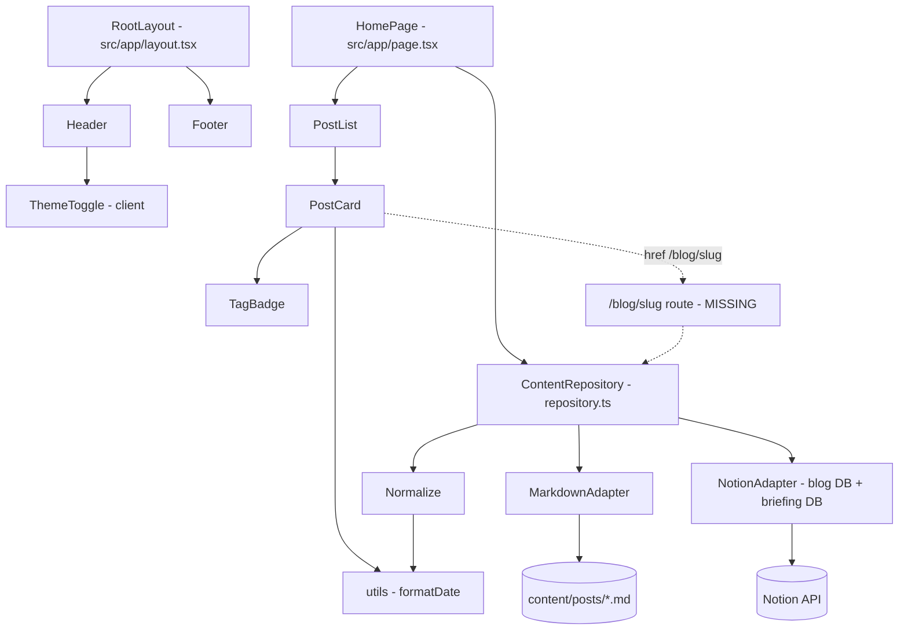
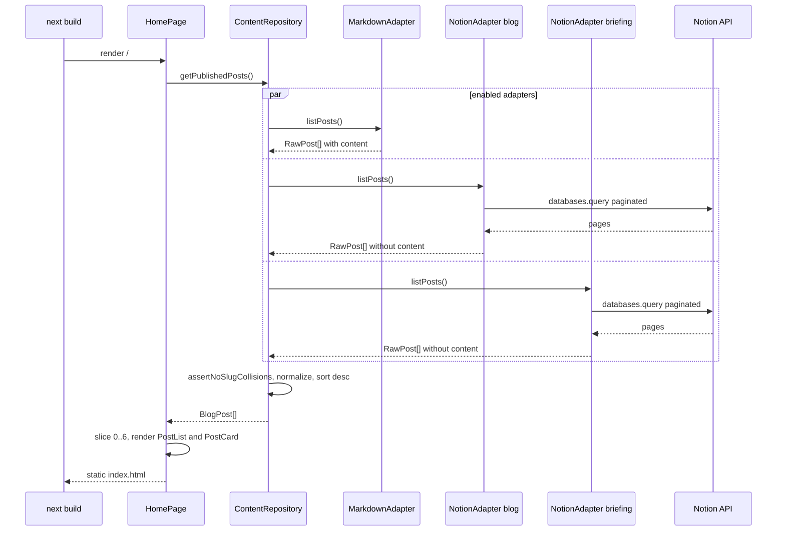
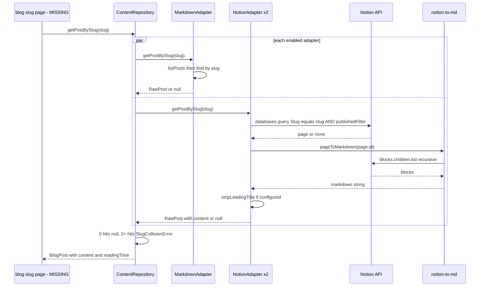

# 아키텍처 — ian-blog

## Architecture Analysis

### System Overview

Next.js 14 App Router 기반 단일 애플리케이션이다. 빌드 시점에 서버 컴포넌트가 콘텐츠 저장소(repository)를 호출하고, 저장소는 원천별 어댑터(마크다운 1개, Notion 2개)에서 글을 모아 정규화한 뒤 페이지에 전달한다. 결과물은 `out/`에 정적 HTML로 export되어 CDN(CloudFront 전제)에서 서빙된다. 런타임 서버나 HTTP API는 없다.

### Architectural Style

정적 사이트 생성(SSG) 모놀리스 + 어댑터(포트/어댑터) 패턴의 콘텐츠 계층.

- 근거: `next.config.js:3` `output: 'export'`, `src/app/`에 `route.ts` 없음, `src/lib/content/types.ts`의 `ContentSourceAdapter` 인터페이스와 `repository.ts`의 `ADAPTERS` 배열.

### Component Relationships

텍스트 대체 설명:
- `RootLayout`이 모든 페이지를 `Header`(내부에 클라이언트 컴포넌트 `ThemeToggle`)와 `Footer`로 감싼다.
- `HomePage` → `ContentRepository.getPublishedPosts()` → `MarkdownAdapter`(파일 시스템) + `NotionAdapter` 2개 인스턴스(Notion API) → `Normalize`.
- `HomePage` → `PostList` → `PostCard` → `TagBadge`.
- `PostCard`는 `/blog/<slug>`로 링크하지만 해당 라우트는 없다(점선). 라우트가 생기면 `ContentRepository.getPostBySlug()`를 호출하게 된다.

### Data Flow

1. `next build` 시 `HomePage`(async 서버 컴포넌트)가 `getPublishedPosts()` 호출.
2. 저장소가 `enabled`인 어댑터의 `listPosts()`를 병렬 실행(`Promise.all`). Notion 어댑터는 `NOTION_API_KEY`와 DB ID가 모두 있을 때만 활성.
3. 각 어댑터는 `RawPost`를 반환. 목록 조회 시 Notion은 본문(`content`) 없음, 마크다운은 본문 포함.
4. `assertNoSlugCollisions` → `normalize`(카테고리 기본값, ISO 날짜, 본문 있을 때 `readingTime`) → 게시일 내림차순 정렬.
5. 홈은 상위 6개를 `PostList`에 전달, 정적 HTML로 렌더링.
6. (상세 — 미구현) `getPostBySlug(slug)`는 모든 활성 어댑터에 슬러그를 질의하고, Notion 히트 시 `notion-to-md`로 페이지 블록을 마크다운 문자열로 변환해 `content`에 담아 반환한다.

### Key Design Decisions

- **원천 분리 정책**: 하나의 슬러그는 정확히 한 원천에만 존재해야 하며 위반 시 빌드 실패(`SlugCollisionError`). 장점: 모호성 제거. 단점: 원천 간 이동 시 빌드가 깨짐.
- **설정 기반 Notion 어댑터 팩토리**(`createNotionAdapter`): DB마다 속성 이름이 달라도 매핑으로 흡수. 두 Notion DB 모두 `source: 'notion'`으로 표기된다.
- **본문은 상세에서만 조회**: 목록에서 Notion 블록 조회를 피해 빌드 비용 절감(`BlogPost.content` 주석 "populated only on detail page"). 결과적으로 Notion 글은 목록에서 `readingTime`이 없다.
- **정적 export**: 서버 비용 0, 대신 동적 라우트는 `generateStaticParams`가 필수이고 `next.config.js`의 `headers()`는 적용되지 않는다.

### Improvement Opportunities

- 상세 라우트(`src/app/blog/[slug]/page.tsx`) 추가: `generateStaticParams` ← `getAllSlugs()`, 본문 렌더링은 이미 설치된 react-markdown + remark-gfm(+ 필요 시 shiki, `prose` 타이포그래피)로.
- 상세 조회 시 어댑터 3개 모두에 질의 → 빌드 시 슬러그당 Notion 쿼리 2회 + 블록 조회. 글 수가 늘면 속도 제한 대응(직렬화/캐시) 필요.
- Notion 업로드 이미지 서명 URL 만료 문제(빌드 시 다운로드 또는 외부 호스팅) — [code-quality-assessment.md](code-quality-assessment.md) 참조.
- 보안 헤더를 호스팅 계층(CloudFront 응답 헤더 정책)으로 이전.

## Interaction Diagrams

### BT1 — 빌드 타임 홈 목록 생성

텍스트 대체 설명: 빌드가 `/`를 렌더링하면 `HomePage`가 저장소에 전체 게시글을 요청한다. 저장소는 활성 어댑터들의 `listPosts()`를 병렬 호출하며, Notion 어댑터는 `databases.query`를 페이지네이션하며 호출한다. 결과를 합쳐 충돌 검사, 정규화, 정렬 후 반환하고, 홈은 상위 6개를 카드로 렌더링해 정적 HTML을 만든다.

### BT2 — 글 상세 조회(데이터 계층만 존재, 라우트 미구현)

텍스트 대체 설명: (향후) 상세 페이지가 `getPostBySlug(slug)`를 호출하면 저장소가 모든 활성 어댑터에 병렬 질의한다. 마크다운 어댑터는 전체 목록에서 슬러그를 찾는다. Notion 어댑터는 슬러그+게시 필터로 DB를 질의하고, 찾으면 `notion-to-md`가 블록을 재귀 조회해 마크다운으로 변환한다(브리핑 DB는 선두 `# 제목` 제거). 히트가 없으면 `null`, 둘 이상이면 충돌 오류, 하나면 정규화된 `BlogPost`(본문, 읽기 시간 포함)를 반환한다.
