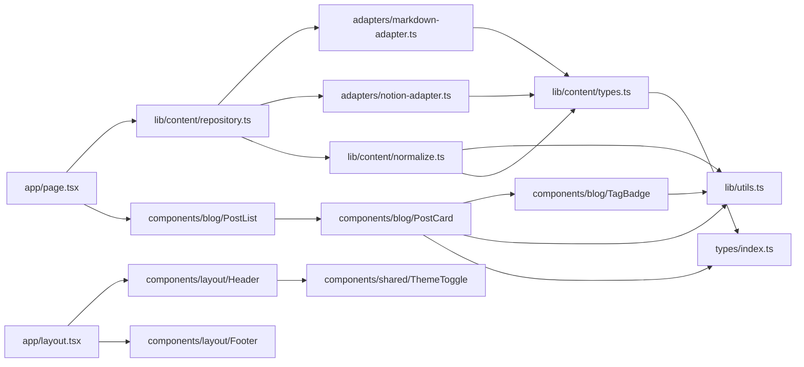

# 의존성 — ian-blog

버전과 사용 여부의 단일 목록은 [technology-stack.md](technology-stack.md)에 있다. 이 문서는 의존 관계만 다룬다.

## 내부 모듈 의존 그래프

텍스트 대체 설명(인접 리스트):
- `app/page.tsx` → `repository.ts`, `PostList`
- `app/layout.tsx` → `Header`, `Footer`; `Header` → `ThemeToggle`
- `PostList` → `PostCard` → `TagBadge`, `utils.ts`, `types`
- `repository.ts` → `markdown-adapter.ts`, `notion-adapter.ts`, `normalize.ts`
- `normalize.ts` → `utils.ts`, `content/types.ts`; 어댑터 2개 → `content/types.ts` → `types/index.ts`

순환 참조: 없음.

## 외부 의존 — 모듈별 사용처

| 패키지 | 사용 모듈 |
|---|---|
| `next` (`next/link`, `next/image`, `next/font/google`) | `page.tsx`, `layout.tsx`, `PostCard`, `TagBadge`, `Header`, `Footer` |
| `react` | `ThemeToggle`(훅), 전체 JSX |
| `@notionhq/client` | `notion-adapter.ts` |
| `notion-to-md` | `notion-adapter.ts` |
| `gray-matter`, `glob` | `markdown-adapter.ts` |
| `clsx`, `tailwind-merge` | `utils.ts` |
| `@tailwindcss/typography` | `tailwind.config.ts`(플러그인) |
| `react-markdown`, `remark-gfm`, `rehype-raw`, `shiki` | 사용처 없음 — 상세 본문 렌더링 후보 |

## 외부 서비스

| 서비스 | 시점 | 실패 시 동작 |
|---|---|---|
| Notion API | 빌드 시 | `NOTION_API_KEY`/DB ID 없으면 해당 어댑터 비활성(조용히 제외). 키가 있는데 API 오류가 나면 예외가 전파되어 빌드 실패(재시도·폴백 없음) |
| Google Fonts(`next/font`) | 빌드 시 | 폰트 다운로드 실패 시 빌드 경고/실패 가능 |
| Notion 파일 호스팅(S3 서명 URL) | 브라우저 런타임 | 본문 내 Notion 업로드 이미지는 URL 만료 후 깨짐 |

## 의존성 위생

- `package-lock.json`과 `yarn.lock`이 공존 → 해석 버전 불일치 가능.
- 미사용 런타임 의존성 4개(위 표). 상세 렌더링에 채택하지 않을 경우 제거 대상.
